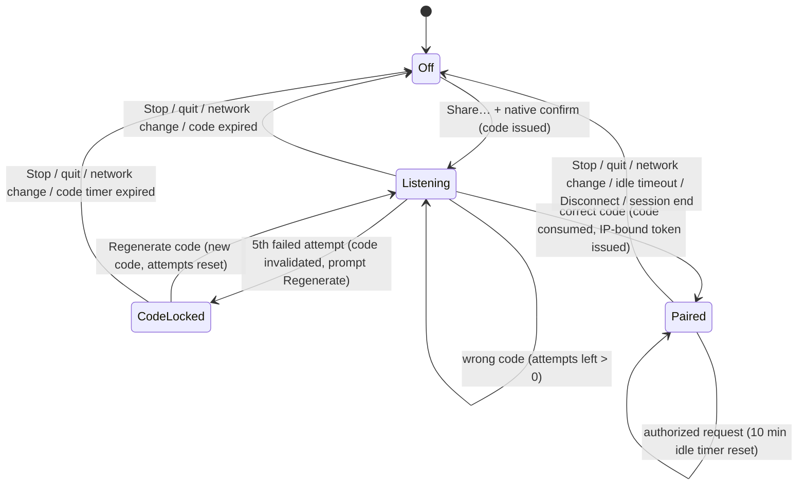

# ADR 0008: Session-Scoped Local LAN Book Sync

**Status:** Accepted for issue #132 (tracking issues #133–#149). Revisit if encryption (TLS/PAKE), background sync, or discovery (mDNS/Bonjour) is added.

## Context

SynapseRead is a local-first desktop app whose contributor policy (`AGENTS.md`) previously prohibited all network calls. Users who read on two desktop devices on the same local network (for example, two Macs at home) need a way to copy books, reading positions, and bookmarks between devices without accounts, cloud servers, or manual file transfers.

Any network capability widens the app's attack surface and changes its privacy boundary. Before any socket or HTTP code lands on `main`, this ADR establishes the sole, narrow exception to the no-network policy, defines "LAN" in testable terms, documents the plaintext HTTP threat model and its accepted residual risks, and specifies the V1 architecture, wire protocol, and safety invariants.

This document and GitHub issues `#132`–`#149` are the sole authoritative specification for V1 LAN book sync.

## Owner Decisions (`OD-1`–`OD-13`)

| ID      | Decision                            | Adopted V1 Policy                                                                                                                                                                                                                                                                              |
| ------- | ----------------------------------- | ---------------------------------------------------------------------------------------------------------------------------------------------------------------------------------------------------------------------------------------------------------------------------------------------- |
| `OD-1`  | LAN policy exception & peer rules   | Adopt narrow LAN exception in `AGENTS.md` + ADR 0008; restrict to private IPv4 same-subnet peers; allow `169.254/16` link-local; surface a source-side notice when an out-of-subnet peer is blocked.                                                                                           |
| `OD-2`  | Milestone & native acceptance       | Place alongside/after M4 signing; require Apple-signed builds launched from Finder for two-Mac native macOS acceptance (with single-Mac bind check `UA-4` run early in `#139` and `Info.plist` `plutil -p` check `UA-6` in `#143`).                                                            |
| `OD-3`  | Plaintext HTTP transport            | Accept plaintext HTTP in V1 with documented residual risks (`S-1`–`S-3`) and mandatory V1 mitigations (`S-4`–`S-14`).                                                                                                                                                                          |
| `OD-4`  | Listener lifecycle                  | Session-scoped only (explicitly started by the user; zero launch-time auto-start and no persisted "enabled" flag).                                                                                                                                                                             |
| `OD-5`  | Pairing code & 5-failure transition | 6 CSPRNG digits, 10 min expiry, single-use, 5 failed attempts + per-IP throttle. On 5 failures, lock the current code and prompt **Regenerate code** (listener remains until timeout or **Stop**).                                                                                             |
| `OD-6`  | Managed library storage & disk full | Store imported files at `<app-data>/library/<sha256>.<ext>` (staged in `<app-data>/sync-staging/`); map `ENOSPC`/`EDQUOT` to `lan_disk_full` with cleanup.                                                                                                                                     |
| `OD-7`  | Per-bookmark version binding        | Defer. V1 requires **zero SQLite schema migrations**; bookmark drift from earlier relinks is reproduced, not repaired.                                                                                                                                                                         |
| `OD-8`  | Bookmark defaults & timestamps      | Default ON for healthy matching books (with per-item deselection); preserve valid source `createdAt` timestamps (falling back to current time).                                                                                                                                                |
| `OD-9`  | Source device name                  | Omit device/host names from `/v1/hello` and V1 UI; identify the source by `ip:port` only.                                                                                                                                                                                                      |
| `OD-10` | Crate placement & dependencies      | New Tauri-free `crates/synapse-lan` (`unsafe_code = "forbid"`), reusing caller's Tokio runtime, `hyper`/`hyper-util` HTTP/1 features, and an interface-enumeration crate (`netdev` vs `if-addrs`) verified for `netmask` + `up`/`broadcast`/`point-to-point` flags across macOS/Linux/Windows. |
| `OD-11` | Native confirmation before sharing  | Required. Starting a share shows a native OS confirmation dialog from Rust (`tauri-plugin-dialog`) before opening any socket.                                                                                                                                                                  |
| `OD-12` | UI entry points                     | Two File-menu commands (`"Share Books on This Network…"` and `"Import from Another Device…"`) opening modal dialogs, exposed atomically in `fixtures/contract/commands.json` only when both dialogs are complete (`#149`).                                                                     |
| `OD-13` | V1 non-goals                        | Annotations, highlights, notes, captures, MindMap cards, reading preferences, PDF layouts, deletion propagation, two-way/auto sync, internet sync, TLS/PAKE, mDNS/Bonjour, IPv6, and Windows release are out of V1 scope.                                                                      |

## Policy Exception & Testable Definition of "LAN"

SynapseRead remains local-first with zero telemetry, zero accounts, and zero internet or third-party host connections. The **only** permitted network activity is user-initiated, session-scoped LAN book sync between two SynapseRead desktop instances:

- **Direction and duration:** Pull-only. The source is strictly read-only. No listener starts at app launch; a listener exists only during an explicit sharing session confirmed via a native Rust dialog.
- **Addressing:** IPv4 literals only (`a.b.c.d` or `a.b.c.d:port`). Zero DNS resolution, zero mDNS/Bonjour, and zero broadcast or multicast discovery.
- **Source bind candidates:** Interfaces that are `up`, not loopback, broadcast-capable (excluding point-to-point/VPN tunnels), and carry a private IPv4 address (`10.0.0.0/8`, `172.16.0.0/12`, `192.168.0.0/16`) or link-local address (`169.254.0.0/16`). Bind to the single chosen IPv4 address, never `0.0.0.0`.
- **Port selection (`bind_auto`):** Try `49319`–`49328` via `socket2`, advancing **only** on `EADDRINUSE`. `EADDRNOTAVAIL` maps to `lan_address_unavailable`; other errors map to `lan_bind_failed`; exhausting the range maps to `lan_ports_exhausted`.
- **Peer and destination filtering:**
  - The source rejects incoming connections from addresses outside the bound interface's IPv4 subnet (and outside private/link-local ranges). When an out-of-subnet peer is blocked, the source emits a lightweight diagnostic event so the Share UI can explain same-subnet / VLAN / guest-network constraints.
  - The receiver rejects hostnames, public IPv4 addresses, multicast, `100.64.0.0/10` (CGNAT), and loopback (except through a test-only constructor).
- **Network change handling:** While sharing, poll interfaces every 5 seconds. If the bound address disappears, stop sharing immediately and end the session (`lan_network_changed`); never rebind silently.

## Data Allowlist vs. Blocklist

- **May travel over LAN (only when permitted by the session scope):**
  - Document file bytes, sanitized title, `DocumentFormat`, validated extension, byte size, SHA-256 hash, and file availability.
  - Saved reading position (`AnchorLocation` and `lastProgress`) when position sharing is enabled.
  - Bookmarks (`AnchorLocation`, sanitized label, `createdAt`) when bookmark sharing is enabled.
- **Never travels over LAN:**
  - Annotations, highlights, notes, rectangle captures, MindMap cards/edges/layouts, reading preferences, PDF layout settings, local filesystem paths, `last_opened_at` / usage timestamps, and OS device/host names.
  - Wire DTOs in `crates/synapse-lan` are dedicated types that never serialize `synapse_core::domain::Document` directly.

## Threat Model & Accepted Residual Risks

### Accepted Plaintext Residual Risks (`OD-3`)

Because V1 uses plaintext HTTP/1.1 on a trusted LAN, three residual risks are explicitly accepted and disclosed in the UI (_"Use only on networks you trust. Transfers are not encrypted."_):

- **`S-1` Eavesdropping:** Passive observers on the same network segment can read book bytes, titles, reading positions, and bookmark labels.
- **`S-2` Token replay within session window:** An observer who captures the bearer token can replay it until the session ends. Mitigated (not eliminated) by single IP-bound receiver, 10-minute idle timeout, explicit **Disconnect**, and session auto-stop.
- **`S-3` Active tampering or impersonation:** An active attacker (ARP spoofing / rogue AP) can substitute both catalog hashes and book bytes or impersonate a source. SHA-256 verifies integrity against corruption, not against an active attacker. Mitigated by treating all imported bytes, titles, labels, and anchors as untrusted input (ADR 0005 EPUB sandbox/CSP, magic checks, size caps, strict sanitization).

### Mandatory V1 Security & Data-Safety Mitigations

| Risk ID     | Threat / Failure Mode                                          | V1 Mitigation                                                                                                                                                                                                                                                           |
| ----------- | -------------------------------------------------------------- | ----------------------------------------------------------------------------------------------------------------------------------------------------------------------------------------------------------------------------------------------------------------------- |
| `S-4`       | Online brute-force of pairing code                             | 6 CSPRNG digits, 10-minute lifetime, 5 failed attempts lock the code, per-IP throttle, single-use on success.                                                                                                                                                           |
| `S-5`       | Browser cross-origin / DNS rebinding                           | Every request requires `Host == <bound ip:port>` and `X-SynapseRead-Protocol: 1`; POST requires `Content-Type: application/json`; responses set `Cache-Control: no-store` and send zero CORS headers.                                                                   |
| `S-6`       | DoS / handler panic aborting release build (`panic = "abort"`) | Mature HTTP/1.1 parser (`hyper` / `hyper-util`), header read timeout (10 s), headers ≤ 8 KiB, POST body ≤ 4 KiB, ≤ 4 concurrent connections, 1 active file transfer, no `unwrap`/`expect`, router property/fuzz tests.                                                  |
| `S-7`       | Compromised webview exfiltrating library or probing LAN        | Native Rust confirmation dialog (`tauri-plugin-dialog`) before starting a listener; bearer tokens and `expected` cursor snapshots stay in Rust; webview supplies only fixed-format inputs (6-digit code, catalog IDs); private IPv4 destination limits + rate limiting. |
| `S-8`       | Unintended disclosure of changed/unscoped books or hostnames   | Snapshot of `(document_id, snapshot_file_hash)` at session start; single-fd pre-send verification (`409 lan_source_changed`); minimal `/v1/hello` with no hostname.                                                                                                     |
| `S-9`       | Exposure on wrong network                                      | Session-scoped listener, broadcast-capable private interface filter, immediate stop on network change.                                                                                                                                                                  |
| `S-10`      | Path traversal or file overwrite                               | Peer filenames are never used; content-addressed `<app-data>/library/<sha256>.<ext>` with validated extension; `create_new` in `<app-data>/sync-staging/`.                                                                                                              |
| `S-11`      | Partial file loaded by webview                                 | Staging directory is never granted to the Tauri asset scope; exact file path is granted via `access::grant_documents` only after DB commit (ADR 0001).                                                                                                                  |
| `S-12`      | Disk exhaustion                                                | Streaming byte cap matching declared `Content-Length`; `ENOSPC`/`EDQUOT` mapped to `lan_disk_full` with staging cleanup.                                                                                                                                                |
| `S-13`      | Credential leaks                                               | Bearer token sent only in `Authorization` header (never URLs), stored in memory only as SHA-256 digest, redacting `Debug` impls.                                                                                                                                        |
| `S-14`      | LAN scanning through client                                    | Private IPv4 literal filter + client rate limiting.                                                                                                                                                                                                                     |
| `D-1`–`D-2` | Stale debounced cursor write overwriting adopted position      | `Database::replace_cursor_if` CAS + `flushCursorWrites` + `<UnmountSentinel>` `closeDocumentAndFlush` + store refresh per book.                                                                                                                                         |
| `D-3`–`D-5` | Upsert clobbering healthy record or existing bookmarks         | `Database::import_document` repairs missing-file records only; changed local files are ineligible (never routed to `relink_document`); `Database::import_bookmarks` uses `ON CONFLICT DO NOTHING`.                                                                      |
| `D-6`–`D-9` | Mid-import crash orphans or accidental deletion                | Per-book independent commits; cancel deletes only unfinished `.part` staging files; sole-connection startup `reconcile` deletes only unreferenced files inside managed directories.                                                                                     |

## Session Lifecycle, Pairing & Wire Protocol (`/v1`)

### Source State Machine (`OD-5`, `R3-09`)

All timers use an injectable monotonic clock for deterministic tests. Sharing permissions (positions, bookmarks) and the book scope `(document_id, snapshot_file_hash)` are fixed as a snapshot at session start.

### `/v1` Wire Endpoints

Every request must include `Host: <bound ip:port>` and `X-SynapseRead-Protocol: 1`. Every authenticated request includes `Authorization: Bearer <token>`. Every response includes `Cache-Control: no-store` and no CORS headers. Both server and client reuse HTTP/1.1 keep-alive connections (`R3-02`).

| Endpoint                           | Response / Status Codes                                                                                                                                                                               | Notes                                                                                                           |
| ---------------------------------- | ----------------------------------------------------------------------------------------------------------------------------------------------------------------------------------------------------- | --------------------------------------------------------------------------------------------------------------- |
| `GET /v1/hello`                    | `200 {"protocol":1,"minProtocol":1,"app":"synapseread"}`                                                                                                                                              | Unauthenticated; no device name.                                                                                |
| `POST /v1/pair`                    | `200 {"token":"…","idleTimeoutSeconds":600,"permissions":{"positions":bool,"bookmarks":bool}}` `401 lan_auth_invalid`, `410 lan_auth_expired`, `429 lan_attempts_exceeded`, `409 lan_session_busy` | Body `{"code":"123456"}`, `Content-Type: application/json`.                                                     |
| `GET /v1/catalog`                  | `200 {"books":[{"id":"<sha256>","title":"…","format":"epub","extension":"epub","sizeBytes":123,"fileAvailable":true,"hasPosition":true,"bookmarkCount":3}]}`                                          | `hasPosition` and `bookmarkCount` included only when permitted.                                                 |
| `GET /v1/books/{sha256}/file`      | `200` raw bytes + exact `Content-Length` `404`, `409 lan_source_changed`, `429 lan_transfer_busy`                                                                                                  | Single-fd open → hash → `fstat` → `seek(0)` → stream (`R3-03`); verifies `doc.file_hash == snapshot_file_hash`. |
| `GET /v1/books/{sha256}/position`  | `200 {"anchor":{…},"progress":0.42\|null}` or `204` `403 lan_scope_denied`, `409 lan_source_changed`                                                                                               | Verifies snapshot hash (`R3-03`).                                                                               |
| `GET /v1/books/{sha256}/bookmarks` | `200 {"bookmarks":[{"anchor":{…},"label":"…","createdAt":"…"}]}` `403 lan_scope_denied`, `409 lan_source_changed`                                                                                  | Verifies snapshot hash (`R3-03`).                                                                               |
| `POST /v1/session/end`             | `204`                                                                                                                                                                                                 | Ends paired session cleanly (called on Done/Disconnect, not when clicking **Back to catalog**).                 |

**Compatibility rules:** Within `/v1`, fields are only added; receivers ignore unknown fields. On `/position` and `/bookmarks`, raw response bytes are stream-capped before JSON parsing, and each wire `anchor` is deserialized into `serde_json::Value` first so unknown future anchor formats skip per entry instead of failing the response (`R2-05`). Golden fixtures live in `fixtures/contract/lan-sync-v1/` and are tested by both server and client.

### Limits & Timers

| Category       | Limit                                                                                                                                                                                                                              |
| -------------- | ---------------------------------------------------------------------------------------------------------------------------------------------------------------------------------------------------------------------------------- |
| Pairing code   | 6 CSPRNG digits, 10 min expiry, 5 failures → `CodeLocked`, single-use, revoked on regenerate                                                                                                                                       |
| Session        | 1 receiver (bound to peer IP), 10 min idle timeout (active transfer counts as activity), no absolute cap                                                                                                                           |
| Interface poll | Every 5 s while sharing                                                                                                                                                                                                            |
| Server         | Header read timeout 10 s; headers ≤ 8 KiB; POST body ≤ 4 KiB; ≤ 4 connections; 1 active file transfer                                                                                                                              |
| Client         | Connect timeout 5 s; inactivity timeout 30 s; planner metadata concurrency ≤ 2 (cancellable, keep-alive); catalog ≤ 8 MiB; bookmarks ≤ 2 MiB/book; position ≤ 64 KiB                                                               |
| Fields         | Title ≤ 512 chars; bookmark label ≤ 80 chars; CFI ≤ 4 KiB; href ≤ 1 KiB; `rects` ≤ 256; `pageSpans` ≤ 64; ≤ 10,000 bookmarks/book; ≤ 10,000 catalog books; C0/C1 and bidi controls (`U+202A`–`U+202E`, `U+2066`–`U+2069`) stripped |

### Stable Error Codes (`CoreError::code()` / `IpcError`)

- **Address & listener:** `lan_address_invalid`, `lan_address_unavailable`, `lan_bind_failed`, `lan_ports_exhausted`, `lan_network_changed`
- **Connection:** `lan_unreachable`, `lan_protocol_incompatible`, `lan_source_stopped`
- **Authorization:** `lan_auth_invalid`, `lan_auth_expired`, `lan_attempts_exceeded`, `lan_session_busy`, `lan_scope_denied`
- **Transfer:** `lan_transfer_busy`, `lan_source_changed`, `lan_size_mismatch`, `lan_hash_mismatch`, `lan_payload_too_large`, `lan_disk_full`, `lan_cancelled`
- **Merge:** `lan_position_conflict`, plus existing `invalid_anchor` and `unsupported_format`

## Architectural Decisions & Codebase Refinements (`R2-01`–`R2-07`, `R3-01`–`R3-11`)

1. **Crate boundary (`OD-10`, `R3-10`):**
   - `crates/synapse-core` owns DB persistence (`import_document`, `import_bookmarks`, `replace_cursor_if`, export queries), `ManagedLibrary`/`StagedFile`/reconciliation, input sanitizers, and lock-free hashing helpers (`#134`).
   - `crates/synapse-lan` is a new Tauri-free crate (`unsafe_code = "forbid"`) owning address policy, `bind_auto`, pairing/session state, HTTP/1.1 server/client, and the import orchestrator (`plan_import` / `execute_import`). It runs on the caller's Tokio runtime and is tested on Ubuntu CI alongside `synapse-core`.
   - `apps/desktop/src-tauri` remains a thin adapter: native share confirmation, Tauri `Channel` progress streaming, cancellation registry, asset-scope grants, lifecycle teardown, and `Info.plist`.
   - Existing `Cargo.lock` major versions (`base64`, `sha2`, `hyper`, `hyper-util`, `tokio`, `socket2`) are pinned to avoid duplicate dependency graphs (`R2-04`). Interface enumeration (`netdev` vs `if-addrs`) is evaluated in `#139` for `netmask` and `up`/`broadcast`/`point-to-point` flags across macOS/Linux/Windows (`R3-10`).

2. **Markdown extension preservation & bounded EPUB validation (`R2-01`, `R2-04`, `R3-08`):**
   - Because `documentFormatLabel` and ADR 0007 detect Markdown via `.md`/`.markdown` extensions on `documents.file_path` (while DB `format` is `txt`), incoming `extension` is strictly validated against `DocumentFormat::extensions` and preserved in `<app-data>/library/<sha256>.<ext>`.
   - When repairing a missing local record, `execute_import` resolves any existing record's original extension _before_ calling `StagedFile::finish` so the published path retains the expected extension (`R3-08`).
   - EPUB magic validation uses a bounded pure-Rust ZIP Central Directory check (verifying `mimetype == "application/epub+zip"`, tolerating EPUBs where `mimetype` is not entry 0 or is deflated) without adding a `zip` crate dependency (`R2-04`).

3. **Sole-connection reconciliation (`R3-01`, `R3-08`):**
   - `Database::open` acquires an exclusive session lock (`acquire_session_lock` / `is_sole_connection`) before downgrading to a shared lock. `ManagedLibrary::reconcile` runs **only** inside that sole-connection window so a second concurrent SynapseRead instance can never delete another instance's active `.part` or freshly published files. `reconcile` matches canonicalized full paths against `documents.file_path`.

4. **Single-fd source streaming & snapshot hash binding (`R3-03`):**
   - `/v1/books/{sha256}/file` opens the source `File` **once**, hashes it, calls `file.metadata()` (`fstat`), seeks to `0`, and streams from the same file descriptor—eliminating atomic-rename TOCTOU races.
   - The session snapshot stores `(document_id, snapshot_file_hash)`, and `/file`, `/position`, and `/bookmarks` verify `doc.file_hash == snapshot_file_hash` (returning `409 lan_source_changed` if relinked mid-session).

5. **Keep-alive & bounded planner concurrency (`R3-02`):**
   - Both server and client use HTTP/1.1 keep-alive. `plan_import` bounds concurrent metadata requests (`/position` + `/bookmarks`) to `<= 2` and supports cancellation so previewing large selections never saturates the server's 4-connection cap.

6. **IPC error shape & Rust-owned `expected` cursor snapshots (`R3-07`):**
   - `IpcError` remains strictly `{ code, message }`. The macOS Local Network troubleshooting hint is derived client-side when `code === "lan_unreachable" && detectPlatform() === "mac"`.
   - `expected: CursorSnapshot` values for `replace_cursor_if` stay inside Rust `ImportPlan` session state rather than round-tripping through WebView JSON.

7. **Per-book asset grants & full shutdown teardown (`R2-03`, `R2-07`, `R3-05`):**
   - During `execute_import`, the Tauri adapter calls `access::grant_documents` for each imported or repaired book **before** emitting that book's completion progress event over Tauri `Channel`, so **Continue reading** works immediately as each book completes (`R2-07`).
   - Active sharing sessions **and** active receiver `plan_import`/`execute_import` tasks are torn down across `WindowEvent::CloseRequested`, `request_app_exit` / `spawn_exit_flush`, and `RunEvent::Exit` (`R2-03`, `R3-05`).

8. **Frontend cursor-write barrier, `<UnmountSentinel>`, & store refresh (`R2-02`, `R3-06`):**
   - `useStudySyncStore` tracks in-flight `updateDocumentCursor` promises per document and exposes `flushCursorWrites(id)`.
   - Because React runs parent `useEffect` cleanups before child `<Viewer>` cleanups, `DocumentTab` mounts a sibling `<UnmountSentinel>` **after** `<Viewer>` (keeping viewers 100% callback-only). `closeDocumentAndFlush(id)` awaits `<UnmountSentinel>`'s unmount resolution (skipping the wait when no viewer is mounted, e.g., headless tests or `SourceRecoveryDialog`), awaits `flushCursorWrites(id)`, and blocks premature reopen until apply finishes.
   - `refreshDocument(id)` and `refreshBookmarks(id)` perform targeted merges from existing `listDocuments()` / `listBookmarks()`. On missing-file recovery, `refreshDocument` resets `documentSourceStatuses[id]` to `ok` and increments `relinkedNonceByDocumentId[id]` so an open `SourceRecoveryDialog` transitions cleanly back to `<Viewer>`.
   - `describeResumeLocation` is extracted into a shared reader module so the Import dialog summarizes reading positions without inspecting `AnchorLocation` directly (preserving `AGENTS.md`'s format-agnostic anchor boundary).

9. **Modal accessibility, Focus Mode visibility, & atomic menu activation (`R2-06`, `R3-04`, `R3-09`, `R3-11`):**
   - LAN sync dialogs share an accessible modal shell in `features/lanSync/` with Tab focus trap, focus restoration, Escape/backdrop guard during active transfers, and a `commands/registry.ts` modal guard that blocks background modified shortcuts (`⌘W`, `⌘O`, `⌘D`, `⇧⌘F`) while preserving text-editing keys in inputs.
   - The active-sharing indicator lives in `StudyWorkspace.tsx`'s `workspaceControls` (staying mounted when no book is open) and remains visible in Focus Mode.
   - Import Results includes **Back to catalog** (keeping the paired session alive; `/v1/session/end` is sent only on **Done** / **Disconnect**).
   - Menu labels are cross-platform (`"Share Books on This Network…"` and `"Import from Another Device…"`), and both `file.shareOnNetwork` and `file.importFromDevice` are added to `fixtures/contract/commands.json` atomically in `#149` so `main` never ships a one-sided menu.

## Native macOS Validation Prerequisites (`OD-2`)

Per Apple TN3179 and macOS firewall behavior:

- Outgoing TCP connections to local addresses require macOS Local Network privacy approval (receiver), while incoming TCP accepts are governed by the macOS Application Firewall (source).
- `apps/desktop/src-tauri/Info.plist` must declare `NSLocalNetworkUsageDescription` (verified via `plutil -p` in `#143`, `UA-6`), with no Bonjour keys.
- Because Terminal/dev launches bypass Local Network privacy and ad hoc signatures behave inconsistently, native two-Mac acceptance (`#147`) requires Apple-signed builds launched from Finder (dependent on M4 code signing).
- Observed OS/chip/WebKit/signing evidence and `UA-1`–`UA-17` resolutions will be appended to this ADR in `#147`.

## What Would Reverse This

Revisit and supersede this ADR if SynapseRead ever:

- Adds transport encryption (TLS with pairing-pinned certificates or PAKE) to support untrusted/shared Wi-Fi networks.
- Introduces background, automatic, or launch-time sync listeners.
- Adds mDNS/Bonjour discovery, QR pairing, IPv6, or cloud/relay sync.
- Expands sync scope to annotations, notes, captures, MindMap cards, or deletion propagation.
