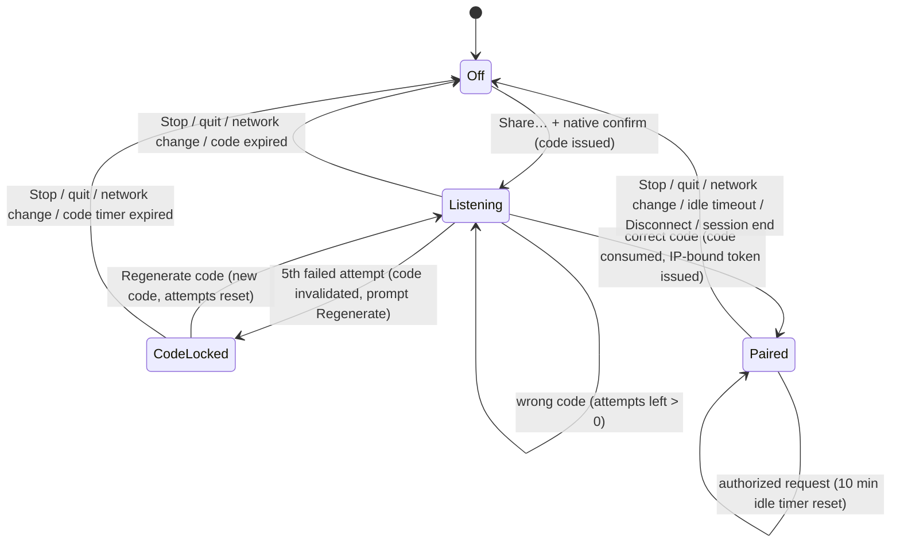

# ADR 0008: Session-Scoped Local LAN Book Sync

**Status:** Accepted for issue #132 (tracking issues #133–#149). Revisit if encryption (TLS/PAKE), background sync, or discovery (mDNS/Bonjour) is added.

## Context

SynapseRead is a local-first desktop app whose contributor policy (`AGENTS.md`) previously prohibited all network calls. Users who read on two desktop devices on the same local network (for example, two Macs at home) need a way to copy books, reading positions, and bookmarks between devices without accounts, cloud servers, or manual file transfers.

Any network capability widens the app's attack surface and changes its privacy boundary. Before any socket or HTTP code lands on `main`, this ADR establishes the sole, narrow exception to the no-network policy, defines "LAN" in testable terms, documents the plaintext HTTP threat model and its accepted residual risks, and specifies the V1 architecture, wire protocol, and safety invariants.

This document and GitHub issues `#132`–`#149` are the sole authoritative specification for V1 LAN book sync.

## Owner Decisions (`OD-1`–`OD-13`)

| ID      | Decision                            | Adopted V1 Policy                                                                                                                                                                                                                                                                                                                                                                                                                                                                                                                                                                                                                                                                                                                                                                                                                                       |
| ------- | ----------------------------------- | ------------------------------------------------------------------------------------------------------------------------------------------------------------------------------------------------------------------------------------------------------------------------------------------------------------------------------------------------------------------------------------------------------------------------------------------------------------------------------------------------------------------------------------------------------------------------------------------------------------------------------------------------------------------------------------------------------------------------------------------------------------------------------------------------------------------------------------------------------- |
| `OD-1`  | LAN policy exception & peer rules   | Adopt narrow LAN exception in `AGENTS.md` + ADR 0008; restrict to private IPv4 same-subnet peers; allow `169.254/16` link-local; surface a source-side notice when an out-of-subnet peer is blocked.                                                                                                                                                                                                                                                                                                                                                                                                                                                                                                                                                                                                                                                    |
| `OD-2`  | Milestone & native acceptance       | **Rev 2 (2026-11-24, owner decision; supersedes the Apple-signed gate):** Apple Developer ID signing & notarization (`PR #172`) is an optional distribution path, not a V1 gate. Native two-Mac acceptance (`#147`) uses packaged builds from one commit SHA, installed in `/Applications/` on two macOS 15+ Macs and launched from Finder, signed either with a local self-signed Code Signing certificate (`scripts/macos-build-signed.sh --local-sign`) or ad hoc with a bound `Info.plist` (`--adhoc-sign`). The Apple Developer ID arm of `T-49` / `UA-8` is an owner-accepted deferred exception. _Original:_ Place alongside/after M4 signing; require Apple-signed builds launched from Finder for two-Mac native macOS acceptance (with single-Mac bind check `UA-4` run early in `#139` and `Info.plist` `plutil -p` check `UA-6` in `#143`). |
| `OD-3`  | Plaintext HTTP transport            | Accept plaintext HTTP in V1 with documented residual risks (`S-1`–`S-3`) and mandatory V1 mitigations (`S-4`–`S-14`).                                                                                                                                                                                                                                                                                                                                                                                                                                                                                                                                                                                                                                                                                                                                   |
| `OD-4`  | Listener lifecycle                  | Session-scoped only (explicitly started by the user; zero launch-time auto-start and no persisted "enabled" flag).                                                                                                                                                                                                                                                                                                                                                                                                                                                                                                                                                                                                                                                                                                                                      |
| `OD-5`  | Pairing code & 5-failure transition | 6 CSPRNG digits, 10 min expiry, single-use, 5 failed attempts + per-IP throttle. On 5 failures, lock the current code and prompt **Regenerate code** (listener remains until timeout or **Stop**).                                                                                                                                                                                                                                                                                                                                                                                                                                                                                                                                                                                                                                                      |
| `OD-6`  | Managed library storage & disk full | Store imported files at `<app-data>/library/<sha256>.<ext>` (staged in `<app-data>/sync-staging/`); map `ENOSPC`/`EDQUOT` to `lan_disk_full` with cleanup.                                                                                                                                                                                                                                                                                                                                                                                                                                                                                                                                                                                                                                                                                              |
| `OD-7`  | Per-bookmark version binding        | Defer. V1 requires **zero SQLite schema migrations**; bookmark drift from earlier relinks is reproduced, not repaired.                                                                                                                                                                                                                                                                                                                                                                                                                                                                                                                                                                                                                                                                                                                                  |
| `OD-8`  | Bookmark defaults & timestamps      | Default ON for healthy matching books (with per-item deselection); preserve valid source `createdAt` timestamps (falling back to current time).                                                                                                                                                                                                                                                                                                                                                                                                                                                                                                                                                                                                                                                                                                         |
| `OD-9`  | Source device name                  | Omit device/host names from `/v1/hello` and V1 UI; identify the source by `ip:port` only.                                                                                                                                                                                                                                                                                                                                                                                                                                                                                                                                                                                                                                                                                                                                                               |
| `OD-10` | Crate placement & dependencies      | New Tauri-free `crates/synapse-lan` (`unsafe_code = "forbid"`), reusing caller's Tokio runtime, `hyper`/`hyper-util` HTTP/1 features, and an interface-enumeration crate (`netdev` vs `if-addrs`) verified for `netmask` + `up`/`broadcast`/`point-to-point` flags across macOS/Linux/Windows.                                                                                                                                                                                                                                                                                                                                                                                                                                                                                                                                                          |
| `OD-11` | Native confirmation before sharing  | Required. Starting a share shows a native OS confirmation dialog from Rust (`tauri-plugin-dialog`) before opening any socket.                                                                                                                                                                                                                                                                                                                                                                                                                                                                                                                                                                                                                                                                                                                           |
| `OD-12` | UI entry points                     | Two File-menu commands (`"Share Books on This Network…"` and `"Import from Another Device…"`) opening modal dialogs, exposed atomically in `fixtures/contract/commands.json` only when both dialogs are complete (`#149`).                                                                                                                                                                                                                                                                                                                                                                                                                                                                                                                                                                                                                              |
| `OD-13` | V1 non-goals                        | Annotations, highlights, notes, captures, MindMap cards, reading preferences, PDF layouts, deletion propagation, two-way/auto sync, internet sync, TLS/PAKE, mDNS/Bonjour, IPv6, and Windows release are out of V1 scope.                                                                                                                                                                                                                                                                                                                                                                                                                                                                                                                                                                                                                               |

## Policy Exception & Testable Definition of "LAN"

SynapseRead remains local-first with zero telemetry, zero accounts, and zero internet or third-party host connections. The **only** permitted network activity is user-initiated, session-scoped LAN book sync between two SynapseRead desktop instances:

- **Direction and duration:** Pull-only. The source is strictly read-only. No listener starts at app launch; a listener exists only during an explicit sharing session confirmed via a native Rust dialog.
- **Addressing:** IPv4 literals only (`a.b.c.d` or `a.b.c.d:port`). Zero DNS resolution, zero mDNS/Bonjour, and zero broadcast or multicast discovery.
- **Source bind candidates:** Interfaces that are `up`, not loopback, broadcast-capable (excluding point-to-point/VPN tunnels), and carry a private IPv4 address (`10.0.0.0/8`, `172.16.0.0/12`, `192.168.0.0/16`) or link-local address (`169.254.0.0/16`). Bind to the single chosen IPv4 address, never `0.0.0.0`.
- **Port selection (`bind_auto`):** Try `49319`–`49328` via `socket2`, advancing **only** on `EADDRINUSE`. `EADDRNOTAVAIL` maps to `lan_address_unavailable`; other errors map to `lan_bind_failed`; exhausting the range maps to `lan_ports_exhausted`.
- **Peer and destination filtering:**
  - The source rejects incoming connections from addresses outside the bound interface's IPv4 subnet (and outside private/link-local ranges). When an out-of-subnet peer is blocked, the source emits a lightweight diagnostic event so the Share UI can explain same-subnet / VLAN / guest-network constraints.
  - The receiver rejects hostnames, public IPv4 addresses, multicast, `100.64.0.0/10` (CGNAT), and loopback (except through a test-only constructor).
- **Network change handling:** While sharing, poll interfaces every 5 seconds. If the bound address disappears, stop sharing immediately and end the session (`lan_network_changed`); never rebind silently.

## Data Allowlist vs. Blocklist

- **May travel over LAN (only when permitted by the session scope):**
  - Document file bytes, sanitized title, `DocumentFormat`, validated extension, byte size, SHA-256 hash, and file availability.
  - Saved reading position (`AnchorLocation` and `lastProgress`) when position sharing is enabled.
  - Bookmarks (`AnchorLocation`, sanitized label, `createdAt`) when bookmark sharing is enabled.
- **Never travels over LAN:**
  - Annotations, highlights, notes, rectangle captures, MindMap cards/edges/layouts, reading preferences, PDF layout settings, local filesystem paths, `last_opened_at` / usage timestamps, and OS device/host names.
  - Wire DTOs in `crates/synapse-lan` are dedicated types that never serialize `synapse_core::domain::Document` directly.

## Threat Model & Accepted Residual Risks

### Accepted Plaintext Residual Risks (`OD-3`)

Because V1 uses plaintext HTTP/1.1 on a trusted LAN, three residual risks are explicitly accepted and disclosed in the UI (_"Use only on networks you trust. Transfers are not encrypted."_):

- **`S-1` Eavesdropping:** Passive observers on the same network segment can read book bytes, titles, reading positions, and bookmark labels.
- **`S-2` Token replay within session window:** An observer who captures the bearer token can replay it until the session ends. Mitigated (not eliminated) by single IP-bound receiver, 10-minute idle timeout, explicit **Disconnect**, and session auto-stop.
- **`S-3` Active tampering or impersonation:** An active attacker (ARP spoofing / rogue AP) can substitute both catalog hashes and book bytes or impersonate a source. SHA-256 verifies integrity against corruption, not against an active attacker. Mitigated by treating all imported bytes, titles, labels, and anchors as untrusted input (ADR 0005 EPUB sandbox/CSP, magic checks, size caps, strict sanitization).

### Mandatory V1 Security & Data-Safety Mitigations

| Risk ID     | Threat / Failure Mode                                          | V1 Mitigation                                                                                                                                                                                                                                                           |
| ----------- | -------------------------------------------------------------- | ----------------------------------------------------------------------------------------------------------------------------------------------------------------------------------------------------------------------------------------------------------------------- |
| `S-4`       | Online brute-force of pairing code                             | 6 CSPRNG digits, 10-minute lifetime, 5 failed attempts lock the code, per-IP throttle, single-use on success.                                                                                                                                                           |
| `S-5`       | Browser cross-origin / DNS rebinding                           | Every request requires `Host == <bound ip:port>` and `X-SynapseRead-Protocol: 1`; POST requires `Content-Type: application/json`; responses set `Cache-Control: no-store` and send zero CORS headers.                                                                   |
| `S-6`       | DoS / handler panic aborting release build (`panic = "abort"`) | Mature HTTP/1.1 parser (`hyper` / `hyper-util`), header read timeout (10 s), headers ≤ 8 KiB, POST body ≤ 4 KiB, ≤ 4 concurrent connections, 1 active file transfer, no `unwrap`/`expect`, router property/fuzz tests.                                                  |
| `S-7`       | Compromised webview exfiltrating library or probing LAN        | Native Rust confirmation dialog (`tauri-plugin-dialog`) before starting a listener; bearer tokens and `expected` cursor snapshots stay in Rust; webview supplies only fixed-format inputs (6-digit code, catalog IDs); private IPv4 destination limits + rate limiting. |
| `S-8`       | Unintended disclosure of changed/unscoped books or hostnames   | Snapshot of `(document_id, snapshot_file_hash)` at session start; single-fd pre-send verification (`409 lan_source_changed`); minimal `/v1/hello` with no hostname.                                                                                                     |
| `S-9`       | Exposure on wrong network                                      | Session-scoped listener, broadcast-capable private interface filter, immediate stop on network change.                                                                                                                                                                  |
| `S-10`      | Path traversal or file overwrite                               | Peer filenames are never used; content-addressed `<app-data>/library/<sha256>.<ext>` with validated extension; `create_new` in `<app-data>/sync-staging/`.                                                                                                              |
| `S-11`      | Partial file loaded by webview                                 | Staging directory is never granted to the Tauri asset scope; exact file path is granted via `access::grant_documents` only after DB commit (ADR 0001).                                                                                                                  |
| `S-12`      | Disk exhaustion                                                | Streaming byte cap matching declared `Content-Length`; `ENOSPC`/`EDQUOT` mapped to `lan_disk_full` with staging cleanup.                                                                                                                                                |
| `S-13`      | Credential leaks                                               | Bearer token sent only in `Authorization` header (never URLs), stored in memory only as SHA-256 digest, redacting `Debug` impls.                                                                                                                                        |
| `S-14`      | LAN scanning through client                                    | Private IPv4 literal filter + client rate limiting.                                                                                                                                                                                                                     |
| `D-1`–`D-2` | Stale debounced cursor write overwriting adopted position      | `Database::replace_cursor_if` CAS + `flushCursorWrites` + `<UnmountSentinel>` `closeDocumentAndFlush` + store refresh per book.                                                                                                                                         |
| `D-3`–`D-5` | Upsert clobbering healthy record or existing bookmarks         | `Database::import_document` repairs missing-file records only; changed local files are ineligible (never routed to `relink_document`); `Database::import_bookmarks` uses `ON CONFLICT DO NOTHING`.                                                                      |
| `D-6`–`D-9` | Mid-import crash orphans or accidental deletion                | Per-book independent commits; cancel deletes only unfinished `.part` staging files; sole-connection startup `reconcile` deletes only unreferenced files inside managed directories.                                                                                     |

## Session Lifecycle, Pairing & Wire Protocol (`/v1`)

### Source State Machine (`OD-5`, `R3-09`)

All timers use an injectable monotonic clock for deterministic tests. Sharing permissions (positions, bookmarks) and the book scope `(document_id, snapshot_file_hash)` are fixed as a snapshot at session start.

### `/v1` Wire Endpoints

Every request must include `Host: <bound ip:port>` and `X-SynapseRead-Protocol: 1`. Every authenticated request includes `Authorization: Bearer <token>`. Every application-routed response includes `Cache-Control: no-store` and no CORS headers (pre-router HTTP/1.1 framing rejections emitted directly by `hyper`, such as `400 Bad Request` or `431 Request Header Fields Too Large`, carry no credentials or book data and are exempt). Both server and client reuse HTTP/1.1 keep-alive connections (`R3-02`).

| Endpoint                           | Response / Status Codes                                                                                                                                                                               | Notes                                                                                                           |
| ---------------------------------- | ----------------------------------------------------------------------------------------------------------------------------------------------------------------------------------------------------- | --------------------------------------------------------------------------------------------------------------- |
| `GET /v1/hello`                    | `200 {"protocol":1,"minProtocol":1,"app":"synapseread"}`                                                                                                                                              | Unauthenticated; no device name.                                                                                |
| `POST /v1/pair`                    | `200 {"token":"…","idleTimeoutSeconds":600,"permissions":{"positions":bool,"bookmarks":bool}}` `401 lan_auth_invalid`, `410 lan_auth_expired`, `429 lan_attempts_exceeded`, `409 lan_session_busy` | Body `{"code":"123456"}`, `Content-Type: application/json`.                                                     |
| `GET /v1/catalog`                  | `200 {"books":[{"id":"<sha256>","title":"…","format":"epub","extension":"epub","sizeBytes":123,"fileAvailable":true,"hasPosition":true,"bookmarkCount":3}]}`                                          | `hasPosition` and `bookmarkCount` included only when permitted.                                                 |
| `GET /v1/books/{sha256}/file`      | `200` raw bytes + exact `Content-Length` `404`, `409 lan_source_changed`, `429 lan_transfer_busy`                                                                                                  | Single-fd open → hash → `fstat` → `seek(0)` → stream (`R3-03`); verifies `doc.file_hash == snapshot_file_hash`. |
| `GET /v1/books/{sha256}/position`  | `200 {"anchor":{…},"progress":0.42\|null}` or `204` `403 lan_scope_denied`, `409 lan_source_changed`                                                                                               | Verifies snapshot hash (`R3-03`).                                                                               |
| `GET /v1/books/{sha256}/bookmarks` | `200 {"bookmarks":[{"anchor":{…},"label":"…","createdAt":"…"}]}` `403 lan_scope_denied`, `409 lan_source_changed`                                                                                  | Verifies snapshot hash (`R3-03`).                                                                               |
| `POST /v1/session/end`             | `204`                                                                                                                                                                                                 | Ends paired session cleanly (called on Done/Disconnect, not when clicking **Back to catalog**).                 |

**Compatibility rules:** Within `/v1`, fields are only added; receivers ignore unknown fields. On `/position` and `/bookmarks`, raw response bytes are stream-capped before JSON parsing, and each wire `anchor` is deserialized into `serde_json::Value` first so unknown future anchor formats skip per entry instead of failing the response (`R2-05`). Golden fixtures live in `fixtures/contract/lan-sync-v1/` and are tested by both server and client.

### Limits & Timers

| Category       | Limit                                                                                                                                                                                                                              |
| -------------- | ---------------------------------------------------------------------------------------------------------------------------------------------------------------------------------------------------------------------------------- |
| Pairing code   | 6 CSPRNG digits, 10 min expiry, 5 failures → `CodeLocked`, single-use, revoked on regenerate                                                                                                                                       |
| Session        | 1 receiver (bound to peer IP), 10 min idle timeout (active transfer counts as activity), no absolute cap                                                                                                                           |
| Interface poll | Every 5 s while sharing                                                                                                                                                                                                            |
| Server         | Header read timeout 10 s; headers ≤ 8 KiB; POST body ≤ 4 KiB; ≤ 4 connections; 1 active file transfer                                                                                                                              |
| Client         | Connect timeout 5 s; inactivity timeout 30 s; planner metadata concurrency ≤ 2 (cancellable, keep-alive); catalog ≤ 8 MiB; bookmarks ≤ 2 MiB/book; position ≤ 64 KiB                                                               |
| Fields         | Title ≤ 512 chars; bookmark label ≤ 80 chars; CFI ≤ 4 KiB; href ≤ 1 KiB; `rects` ≤ 256; `pageSpans` ≤ 64; ≤ 10,000 bookmarks/book; ≤ 10,000 catalog books; C0/C1 and bidi controls (`U+202A`–`U+202E`, `U+2066`–`U+2069`) stripped |

### Stable Error Codes (`CoreError::code()` / `IpcError`)

- **Address & listener:** `lan_address_invalid`, `lan_address_unavailable`, `lan_bind_failed`, `lan_ports_exhausted`, `lan_network_changed`
- **Connection:** `lan_unreachable`, `lan_protocol_incompatible`, `lan_source_stopped`
- **Authorization:** `lan_auth_invalid`, `lan_auth_expired`, `lan_attempts_exceeded`, `lan_session_busy`, `lan_scope_denied`
- **Transfer:** `lan_transfer_busy`, `lan_source_changed`, `lan_size_mismatch`, `lan_hash_mismatch`, `lan_payload_too_large`, `lan_disk_full`, `lan_cancelled`
- **Merge:** `lan_position_conflict`, plus existing `invalid_anchor` and `unsupported_format`

## Architectural Decisions & Codebase Refinements (`R2-01`–`R2-07`, `R3-01`–`R3-11`)

1. **Crate boundary (`OD-10`, `R3-10`):**
   - `crates/synapse-core` owns DB persistence (`import_document`, `import_bookmarks`, `replace_cursor_if`, export queries), `ManagedLibrary`/`StagedFile`/reconciliation, input sanitizers, and lock-free hashing helpers (`#134`).
   - `crates/synapse-lan` is a new Tauri-free crate (`unsafe_code = "forbid"`) owning address policy, `bind_auto`, pairing/session state, HTTP/1.1 server/client, and the import orchestrator (`plan_import` / `execute_import`). It runs on the caller's Tokio runtime and is tested on Ubuntu CI alongside `synapse-core`.
   - `apps/desktop/src-tauri` remains a thin adapter: native share confirmation, Tauri `Channel` progress streaming, cancellation registry, asset-scope grants, lifecycle teardown, and `Info.plist`.
   - Existing `Cargo.lock` major versions (`base64`, `sha2`, `hyper`, `hyper-util`, `tokio`, `socket2`) are pinned to avoid duplicate dependency graphs (`R2-04`). Interface enumeration (`netdev` vs `if-addrs`) is evaluated in `#139` for `netmask` and `up`/`broadcast`/`point-to-point` flags across macOS/Linux/Windows (`R3-10`).

2. **Markdown extension preservation & bounded EPUB validation (`R2-01`, `R2-04`, `R3-08`):**
   - Because `documentFormatLabel` and ADR 0007 detect Markdown via `.md`/`.markdown` extensions on `documents.file_path` (while DB `format` is `txt`), incoming `extension` is strictly validated against `DocumentFormat::extensions` and preserved in `<app-data>/library/<sha256>.<ext>`.
   - When repairing a missing local record, `execute_import` resolves any existing record's original extension _before_ calling `StagedFile::finish` so the published path retains the expected extension (`R3-08`).
   - EPUB magic validation uses a bounded pure-Rust ZIP Central Directory check (verifying `mimetype == "application/epub+zip"`, tolerating EPUBs where `mimetype` is not entry 0 or is deflated) without adding a `zip` crate dependency (`R2-04`).

3. **Sole-connection reconciliation (`R3-01`, `R3-08`):**
   - `Database::open` acquires an exclusive session lock (`acquire_session_lock` / `is_sole_connection`) before downgrading to a shared lock. `ManagedLibrary::reconcile` runs **only** inside that sole-connection window so a second concurrent SynapseRead instance can never delete another instance's active `.part` or freshly published files. `reconcile` matches canonicalized full paths against `documents.file_path`.

4. **Single-fd source streaming & snapshot hash binding (`R3-03`):**
   - `/v1/books/{sha256}/file` opens the source `File` **once**, hashes it, calls `file.metadata()` (`fstat`), seeks to `0`, and streams from the same file descriptor—eliminating atomic-rename TOCTOU races.
   - The session snapshot stores `(document_id, snapshot_file_hash)`, and `/file`, `/position`, and `/bookmarks` verify `doc.file_hash == snapshot_file_hash` (returning `409 lan_source_changed` if relinked mid-session).

5. **Keep-alive & bounded planner concurrency (`R3-02`):**
   - Both server and client use HTTP/1.1 keep-alive. `plan_import` bounds concurrent metadata requests (`/position` + `/bookmarks`) to `<= 2` and supports cancellation so previewing large selections never saturates the server's 4-connection cap.

6. **IPC error shape & Rust-owned `expected` cursor snapshots (`R3-07`):**
   - `IpcError` remains strictly `{ code, message }`. The macOS Local Network troubleshooting hint is derived client-side when `code === "lan_unreachable" && detectPlatform() === "mac"`.
   - `expected: CursorSnapshot` values for `replace_cursor_if` stay inside Rust `ImportPlan` session state rather than round-tripping through WebView JSON.

7. **Per-book asset grants & full shutdown teardown (`R2-03`, `R2-07`, `R3-05`):**
   - During `execute_import`, the Tauri adapter calls `access::grant_documents` for each imported or repaired book **before** emitting that book's completion progress event over Tauri `Channel`, so **Continue reading** works immediately as each book completes (`R2-07`).
   - Active sharing sessions **and** active receiver `plan_import`/`execute_import` tasks are torn down across `WindowEvent::CloseRequested`, `request_app_exit` / `spawn_exit_flush`, and `RunEvent::Exit` (`R2-03`, `R3-05`).

8. **Frontend cursor-write barrier, `<UnmountSentinel>`, & store refresh (`R2-02`, `R3-06`):**
   - `useStudySyncStore` tracks in-flight `updateDocumentCursor` promises per document and exposes `flushCursorWrites(id)`.
   - Because React runs parent `useEffect` cleanups before child `<Viewer>` cleanups, `DocumentTab` mounts a sibling `<UnmountSentinel>` **after** `<Viewer>` (keeping viewers 100% callback-only). `closeDocumentAndFlush(id)` awaits `<UnmountSentinel>`'s unmount resolution (skipping the wait when no viewer is mounted, e.g., headless tests or `SourceRecoveryDialog`), awaits `flushCursorWrites(id)`, and blocks premature reopen until apply finishes.
   - `refreshDocument(id)` and `refreshBookmarks(id)` perform targeted merges from existing `listDocuments()` / `listBookmarks()`. On missing-file recovery, `refreshDocument` resets `documentSourceStatuses[id]` to `ok` and increments `relinkedNonceByDocumentId[id]` so an open `SourceRecoveryDialog` transitions cleanly back to `<Viewer>`.
   - `describeResumeLocation` is extracted into a shared reader module so the Import dialog summarizes reading positions without inspecting `AnchorLocation` directly (preserving `AGENTS.md`'s format-agnostic anchor boundary).

9. **Modal accessibility, Focus Mode visibility, & atomic menu activation (`R2-06`, `R3-04`, `R3-09`, `R3-11`):**
   - LAN sync dialogs share an accessible modal shell in `features/lanSync/` with Tab focus trap, focus restoration, Escape/backdrop guard during active transfers, and a `commands/registry.ts` modal guard that blocks background modified shortcuts (`⌘W`, `⌘O`, `⌘D`, `⇧⌘F`) while preserving text-editing keys in inputs.
   - The active-sharing indicator lives in `StudyWorkspace.tsx`'s `workspaceControls` (staying mounted when no book is open) and remains visible in Focus Mode.
   - Import Results includes **Back to catalog** (keeping the paired session alive; `/v1/session/end` is sent only on **Done** / **Disconnect**).
   - Menu labels are cross-platform (`"Share Books on This Network…"` and `"Import from Another Device…"`), and both `file.shareOnNetwork` and `file.importFromDevice` are added to `fixtures/contract/commands.json` atomically in `#149` so `main` never ships a one-sided menu.

## Native macOS Validation Prerequisites (`OD-2`)

Per Apple TN3179 and macOS firewall behavior:

- Outgoing TCP connections to local addresses require macOS Local Network privacy approval (receiver), while incoming TCP accepts are governed by the macOS Application Firewall (source).
- `apps/desktop/src-tauri/Info.plist` must declare `NSLocalNetworkUsageDescription` (verified via `plutil -p` in `#143`, `UA-6`), with no Bonjour keys.
- Because Terminal/dev launches bypass Local Network privacy and linker-signed `--allow-unsigned` builds leave `Info.plist` unbound, native two-Mac acceptance (`#147`) requires packaged builds signed via `--local-sign` or `--adhoc-sign` (`OD-2 Rev 2`), installed in `/Applications/`, and launched from Finder.
- Observed OS/chip/WebKit/signing evidence and `UA-1`–`UA-17` resolutions are tracked in [Validation Evidence & Assumption Status](#validation-evidence--assumption-status) below (single-Mac baseline and two-Mac Finder acceptance recorded for `#147` / `#132`).

### `OD-2 Rev 2` Amendment (`2026-11-24`)

SynapseRead is a self-used open-source desktop app without a paid Apple Developer Program membership. Requiring a paid Developer ID certificate and Apple notarization would permanently block V1 closure (`#147`, `#132`) even though LAN book sync is feature-complete. Under `OD-2 Rev 2`:

- Paid Apple Developer ID signing and notarization (`PR #172`) remain supported as an **optional** public distribution path, not a V1 LAN Book Sync gate.
- V1 `#147` accepts packaged builds produced from a single commit SHA, installed in `/Applications/SynapseRead.app` on two `macOS 15+` Macs, and launched from **Finder** (never `pnpm dev` or Terminal execution, per Apple TN3179) using either:
  1. **Local self-signed Code Signing certificate** (`scripts/macos-build-signed.sh --local-sign "<identity>"`): signs with `--options runtime --timestamp=none`, binds `Info.plist`, and passes `scripts/verify-macos-bundle.sh --require-local-signed`.
  2. **Ad hoc bound signature** (`scripts/macos-build-signed.sh --adhoc-sign`): signs with `codesign --force --deep --sign -`, binds `Info.plist`, and passes `scripts/verify-macos-bundle.sh --require-adhoc-bound`.
- **TN3179 rebuild persistence caveat:** Apple only guarantees persistent Local Network permission tracking across rebuilds for Apple-issued identities, so rebuild persistence under a local self-signed certificate is observed empirically during `T-49` rather than assumed. Under `--adhoc-sign`, each rebuild changes the CDHash and may require re-granting Local Network and Firewall permissions.
- `--allow-unsigned` (Tauri's default linker-signed bundle where `Info.plist=not bound`) remains invalid for `#147` Finder acceptance.
- The paid Apple Developer ID comparison arm of `T-49` / `UA-8` is recorded as an owner-accepted deferred exception (`N/A until/unless paid Developer ID distribution is adopted`).

## Validation Evidence & Assumption Status

### Single-Mac Baseline & Release Bundle (`2026-11-23`, Baseline `d4e7837`)

Executed on a single macOS host prior to M4 Apple code-signing and second-Mac hardware availability:

- **Host environment:** `macOS 15.6.1 (24G90)`, `Apple M4` (`arm64`, 24 GiB RAM), `WebKit.framework` `20621.3.11.11.3`, Safari `18.6`, `WKWebView` `AppleWebKit/605.1.15`, `Node v24.14.1`, `pnpm 12.16.1`, `rustc 1.99.1 (58cf8f9c3 2026-10-13)`.
- **Release bundle (`pnpm build`):**
  - `SynapseRead.app`: `9.93 MiB` (`Contents/MacOS/synapseread-desktop`: `10,319,488` bytes / `9.84 MiB`, `Mach-O 64-bit executable arm64`).
  - `SynapseRead_0.1.0_aarch64.dmg`: `6,434,272` bytes (`6.14 MiB`), `hdiutil verify` `VALID`.
- **Bundle `Info.plist` (`T-44` / `UA-6`):** `plutil -p target/release/bundle/macos/SynapseRead.app/Contents/Info.plist` confirmed `NSLocalNetworkUsageDescription` (`"SynapseRead uses your local network only when you choose to share or import books with another device on the same network."`) is merged verbatim and `NSBonjourServices` is absent.
- **Code-signing status (`OD-2` / `UA-8`):** `security find-identity -v -p codesigning` reported `0 valid identities found`; `codesign -dv --verbose=4 target/release/bundle/macos/SynapseRead.app` reported `Signature=adhoc` (`flags=0x20002(adhoc,linker-signed)`, `TeamIdentifier=not set`).
- **Host network & firewall baseline:** `socketfilterfw --getglobalstate` reported `Firewall is disabled. (State = 0)`; `sysctl net.inet.ip.portrange` reported `first: 49152`, `last: 65535`, `hifirst: 49152`, `hilast: 65535`.

### Local Automated Checks (Baseline `d4e7837`, `macOS 15.6.1 arm64`)

Run locally on `macOS 15.6.1 (24G90, Apple M4, arm64)` against baseline `d4e7837` (and re-run on `docs/lan-sync-validation` after documentation formatting; GitHub Actions cross-OS CI status is tracked per-PR on GitHub):

- `pnpm check`: passed (`prettier --check .`, `eslint . --max-warnings=0`, `tsc -b --noEmit`, Vitest `62` files / `1144` tests).
- `pnpm e2e`: passed locally (`20/20` Chromium `Chrome/157.0.8103.79` flows including `lan-sync`, `0` CSP violations, `0` page errors).
- `cargo fmt --all --check`: passed.
- `cargo clippy --workspace --all-targets -- -D warnings`: passed.
- `cargo test --workspace`: passed (`synapse-core`: `140 passed`; `synapse-lan`: `91 passed`, `1 ignored` `ua4_t08`; `synapseread-desktop`: `52 passed`, including `T-12`, `T-19`, `T-44`, `T-54`, `T-57`, `R3-05`, and `R3-07`).

### Single-Mac Platform & Hardware Measurements

- **Live interface filtering (`T-06`):** Against active host IPv4 interfaces (`lo0` `127.0.0.1/8`, `en1` `192.168.6.206/24`, `feth365` `192.168.193.238/24`, `utun4` `100.114.162.67/32`), `list_candidate_interfaces(&SystemInterfaceProvider)` returned `en1` (`192.168.6.206/24`) and `feth365` (`192.168.193.238/24`), excluding loopback (`lo0`) and VPN/CGNAT (`utun4`).
- **macOS bind semantics (`T-08` / `UA-4`):** `cargo test -p synapse-lan ua4_t08 -- --ignored --nocapture` passed on `en1 (192.168.6.206/24)`: `bind_auto(192.168.6.206)` bound `192.168.6.206:49319` alongside a `0.0.0.0:49319` wildcard holder, and fell back on `EADDRINUSE` to `192.168.6.206:49320` when `192.168.6.206:49319` was already occupied.
- **Socket options (`UA-5`):** `crates/synapse-lan/src/bind.rs` explicitly configures `SO_REUSEADDR` via `socket2` (`true` on Unix, `false` on Windows); runtime `getsockopt(SO_REUSEADDR) = true` verified on bound listener `192.168.6.206:49319`.
- **Packaged `.app` startup listener check (`T-10`):** Launching `SynapseRead.app/Contents/MacOS/synapseread-desktop` under an isolated `HOME` initialized SQLite with zero TCP `LISTEN` sockets (`lsof -nP -iTCP -sTCP:LISTEN` empty). Active sharing, Stop, window close (`CloseRequested`), and quit listener checks inside the packaged `.app` remain pending in `#147`.
- **Standalone `bind_auto` probe (`T-10` socket probe):** In a separate release probe calling `synapse_lan::bind_auto(192.168.6.206)`, `lsof` showed zero listeners before bind, `TCP 192.168.6.206:49319 (LISTEN)` while bound (single-IP bound, never `*:49319`), and zero listeners after dropping `BoundListener`.
- **Crate dependency footprint (`UA-14`):** `cargo tree -p synapse-lan -e features --depth 2` confirmed HTTP/1-only `hyper 1.12.0` (`client`, `http1`, `server`), `hyper-util 0.1.21` (`http1`, `tokio`), `if-addrs 0.15.0`, `socket2 0.6.5`, and existing workspace major versions (`sha2 0.11.1`, `base64 0.23.1`, `getrandom 0.4.3`), with zero HTTP/2 or Tauri crates.
- **1 GiB SHA-256 throughput (`UA-16`):** Release-mode `synapse_core::fs_reader::hash_file` on `Apple M4` hashed `10 MiB` (`10,485,760` bytes) in `4.32 ms` (`2,315.19 MiB/s`) and `1 GiB` (`1,073,741,824` bytes) in `0.525 s` (`1,949.64 MiB/s`, post-`sync_all`) and `0.439 s` (`2,332.81 MiB/s`, warm cache); multi-GiB files were not directly benchmarked.

### Platform Assumptions (`UA-1`–`UA-17`)

| ID      | Assumption                                                                         | Status                                                                                      | Evidence / Notes                                                                                                                                                                                                                                                                                                                                        |
| ------- | ---------------------------------------------------------------------------------- | ------------------------------------------------------------------------------------------- | ------------------------------------------------------------------------------------------------------------------------------------------------------------------------------------------------------------------------------------------------------------------------------------------------------------------------------------------------------- |
| `UA-1`  | Denied macOS Local Network permission fails BSD `connect` like an unreachable host | Verified (`#147` `M-perm`)                                                                  | On `macOS 15.6.1 (24G90)`, toggling `SynapseRead` OFF in System Settings caused BSD `connect` to fail with `No route to host (os error 65)` (`lan_unreachable` with Local Network recovery hints); toggling ON + **Retry** succeeded (`T-42`, `UA-3-lan-denied`).                                                                                       |
| `UA-2`  | Source replies on accepted sockets need no Local Network grant                     | Verified (`#147` `M-perm`)                                                                  | With `Mac A` (`macOS 15.6.1`) Local Network toggled OFF, `Mac A` listened on `192.168.6.206:49319` (`T-43-source-listening`) and `Mac B` (`192.168.6.184`) imported `small-keep` cleanly (`T-43-receiver-imported`).                                                                                                                                    |
| `UA-3`  | Loopback is exempt from Local Network privacy                                      | Verified (split proof, maintainer sign-off)                                                 | With Finder `.app` Local Network OFF, physical LAN connect failed (`os error 65`, `UA-3-lan-denied`) while `Mac B` listened (`UA-3-peer-sharing`); `cargo test -p synapse-lan` loopback E2E passed (`91 passed; 0 failed; 1 ignored` `ua4_t08`) on `macOS 15.6.1`. Production `AddressPolicy::lan_only()` blocks `127.0.0.1` before connect by design.  |
| `UA-4`  | Specific-address bind coexists with another app's wildcard listener on macOS       | Verified                                                                                    | Verified both in `ua4_t08` (`d4e7837`) and inside the packaged `.app` (`T-08-wildcard-coexist` with `Python *:49319`, and `T-08-specific-fallback` falling back to `:49320` when `192.168.6.206:49319` was held).                                                                                                                                       |
| `UA-5`  | Unix listeners set `SO_REUSEADDR` consistently                                     | Verified                                                                                    | `bind.rs` sets `socket2` `SO_REUSEADDR=true` on Unix (`false` on Windows); `getsockopt` confirmed `true` at runtime.                                                                                                                                                                                                                                    |
| `UA-6`  | Tauri v2 merges `src-tauri/Info.plist` into the `.app` bundle                      | Verified (bundle); Exception (alert modal)                                                  | `verify-macos-bundle.sh` and collector reports verified `NSLocalNetworkUsageDescription` verbatim and zero `NSBonjourServices` (`T-44`). First-run modal screenshot was not captured because `Mac A`'s `clover` account held a prior Local Network entry with no reset control (`UA-12`) and no extra test user was created (owner-accepted exception). |
| `UA-7`  | macOS Application Firewall default state and alert behavior                        | Verified (`#147` `M-pack` / `T-46`)                                                         | Enabling Firewall (`State = 1`) prompted `"你要应用程序“SynapseRead”接受传入网络连接吗？"`; allowing permitted connections (`T-49-adhoc-pre`), blocking `SynapseRead` or enabling `"Block all incoming connections"` caused `Mac B` to fail with `lan_unreachable`, and re-allowing + **Retry** recovered (`T-46`).                                     |
| `UA-8`  | Ad hoc vs Apple-signed behavior with Local Network privacy & firewall              | Verified (`--adhoc-sign`); Deferred (`Developer ID` per `OD-2 Rev 2`); N/A (`--local-sign`) | Replacing `Build 1` (`f51fe87`, `CDHash=fb172279...`) with `Build 2` (`7f47b29`, `CDHash=50bf4cba...`) on `macOS 15.6.1` preserved both Local Network access and Firewall `Allow incoming connections` with zero re-prompt or block (`T-49`). No local Keychain cert was provisioned (`--local-sign` `N/A`); Developer ID deferred per `OD-2 Rev 2`.    |
| `UA-9`  | GitHub-hosted macOS runners bypass Local Network privacy prompts                   | Assumed per Apple TN3179 (dev launch observed in `T-45`)                                    | Apple TN3179 documents Terminal/SSH exemption; locally, `./target/debug/synapseread-desktop` launched from Terminal connected to `192.168.6.184:49319` with zero Local Network prompt (`T-45`), confirming Finder runs are required for permission tests.                                                                                               |
| `UA-10` | `navigator.clipboard.writeText` works in packaged `WKWebView`                      | Verified (`#147` `T-53`)                                                                    | In packaged `WKWebView`, **Copy address** copied `192.168.6.206:49319` cleanly (`Copied` feedback) and manual `⌘C` selection also worked (`T-53`).                                                                                                                                                                                                      |
| `UA-11` | TXT, PDF, and EPUB readers survive hostile imported anchors                        | Verified                                                                                    | Hostile-anchor reader tests (`T-38`) implemented in `#137` (PR #151) and passing in `pnpm test`.                                                                                                                                                                                                                                                        |
| `UA-12` | TN3179 Local Network reset button availability on target macOS                     | Verified (`macOS 15.6.1 (24G90)`)                                                           | `System Settings → Privacy & Security → Local Network` on `macOS 15.6.1 (24G90)` displays only a per-app toggle with no delete/reset button; toggling ON + **Retry** recovered immediately without relaunching (`T-42`).                                                                                                                                |
| `UA-13` | Unthrottled 6-digit pairing code brute-force risk within 10 min window             | Mitigated                                                                                   | `SessionManager` enforces 5 failures -> `CodeLocked`, single-use code, 10 min expiry, and per-IP throttle (`T-01`, `OD-5`).                                                                                                                                                                                                                             |
| `UA-14` | `hyper` HTTP/1 features add minimal transitive crates                              | Verified                                                                                    | Only 3 external crates added to `Cargo.lock` in PR #155 (`httpdate`, `if-addrs`, `tokio-macros`); zero HTTP/2 crates.                                                                                                                                                                                                                                   |
| `UA-15` | `49319`–`49328` overlaps macOS ephemeral port range (`49152`–`65535`)              | Verified                                                                                    | `sysctl net.inet.ip.portrange` = `49152–65535`; `bind_auto` `EADDRINUSE` fallback verified (`T-07`, `T-08`).                                                                                                                                                                                                                                            |
| `UA-16` | Multi-GB SHA-256 takes seconds on Apple Silicon                                    | Measured (1 GiB `hash_file` + dual-Wi-Fi `1.01 GiB` transfer)                               | `Apple M4` release `hash_file`: `10 MiB` in `4.32 ms`, `1 GiB` in `0.439–0.525 s`; over dual Wi-Fi (`T-27`), remaining `~208 MB` transferred in `13 s` (`~16 MB/s`, `~1 min` total for `1.08 GB`); multi-GiB files were not directly benchmarked.                                                                                                       |
| `UA-17` | Guest Wi-Fi networks isolate peer-to-peer LAN clients                              | Owner-accepted Exception (`T-47`)                                                           | No AP/client-isolated guest Wi-Fi router was available in the test environment; unreachable guidance and zero spurious source blocked-peer counts are covered by `synapse-lan` (`t05_rejected_peer_never_reaches_handler_and_emits_event`) and `T-42`/`T-46` `lan_unreachable` runs.                                                                    |

### Two-Mac Finder Validation Evidence (`#147`, `OD-2 Rev 2`, `2026-11-25`–`2026-11-26`)

Executed across two physical Apple Silicon Macs on the same LAN (`192.168.6.206` ↔ `192.168.6.184`) using identical Finder-launched `--adhoc-sign` bundles built from `main` at `f51fe873ce8fb2eaf92f62786e0b4aea4b7fa8ee`, following [`docs/LAN_SYNC_VALIDATION.md`](../LAN_SYNC_VALIDATION.md) and [`scripts/lan-sync-collect-evidence.sh`](../../scripts/lan-sync-collect-evidence.sh). Because `Mac B` ran `macOS 14.7.6` (prior to macOS 15 Local Network privacy), all macOS 15+ Local Network permission checks (`M-perm`: `T-42`, `T-43`, `T-49`, `UA-1`–`UA-3`, `UA-12`) were executed on `Mac A` (`macOS 15.6.1`) against `Mac B` over the physical LAN.

#### Environment Summary (Appendix A)

| Field                  | `Mac A` (Initial Source / `macOS 15+` `M-perm` Host)            | `Mac B` (Initial Receiver)                             |
| ---------------------- | --------------------------------------------------------------- | ------------------------------------------------------ |
| Device / Chip / Arch   | Apple M4 (`arm64`)                                              | Apple M2 Pro (`arm64`)                                 |
| macOS Version & Build  | `macOS 15.6.1 (24G90)`                                          | `macOS 14.7.6 (23H626)`                                |
| Memory                 | `24.0 GiB` (`25,769,803,776` bytes)                             | `16.0 GiB` (`17,179,869,184` bytes)                    |
| `WebKit` Bundle Ver.   | `20621.3.11.11.3`                                               | `19618.3.11.11.5`                                      |
| Source Commit SHA      | `f51fe873ce8fb2eaf92f62786e0b4aea4b7fa8ee` (`Build 1`)          | `f51fe873ce8fb2eaf92f62786e0b4aea4b7fa8ee` (`Build 1`) |
| Signing Mode           | `--adhoc-sign`                                                  | `--adhoc-sign`                                         |
| `codesign -dv` Type    | `adhoc (bound)` (`Info.plist entries=16`)                       | `adhoc (bound)` (`Info.plist entries=16`)              |
| `codesign --verify`    | `valid (passed codesign --verify --deep --strict)`              | `valid (passed codesign --verify --deep --strict)`     |
| `CDHash`               | `fb17227914613dee15b3ab8bc1225cf252410bfc`                      | `fb17227914613dee15b3ab8bc1225cf252410bfc`             |
| Launch Method          | Finder (`/Applications/SynapseRead.app`, `ppid=1`)              | Finder (`/Applications/SynapseRead.app`, `ppid=1`)     |
| Initial Firewall State | Enabled (`State = 1`), `SynapseRead` permitted (`M-pack` entry) | Disabled (`State = 0`)                                 |
| `M-pack` Entry Check   | `20261125T173359-mac-a-M-pack-entry` (`0` listeners)            | `20261125T173400-mac-b-M-pack-entry` (`0` listeners)   |

#### Per-Test Results (`M-perm` & `M-pack`, Appendix B)

| ID                         | Run             | Roles     | Result      | Observed Evidence & Measurements                                                                                                                                                                                                                                                                                                                                                                                                                                                                                         | Sign-off / Notes                                    |
| -------------------------- | --------------- | --------- | ----------- | ------------------------------------------------------------------------------------------------------------------------------------------------------------------------------------------------------------------------------------------------------------------------------------------------------------------------------------------------------------------------------------------------------------------------------------------------------------------------------------------------------------------------ | --------------------------------------------------- |
| `T-45`                     | `Perm`          | `Mac A`   | `Pass`      | Terminal `./target/debug/synapseread-desktop` connected to `192.168.6.184:49319` (`Positions: Included`, `Bookmarks: Included`, `role-swap-book New`) with no Local Network alert (`mac-a-T-45-terminal-connected.png`; process exited prior to collector snapshot).                                                                                                                                                                                                                                                     | Observed live & screenshot archived                 |
| `T-41`                     | `Perm`          | `Mac A/B` | `Exception` | `Mac A` (`clover` account) had prior Local Network approval cached with no reset button (`UA-12`) and no separate test user was created; **Allow** toggle + **Retry** recovery verified in `T-42`.                                                                                                                                                                                                                                                                                                                       | Owner-accepted exception                            |
| `T-44` / `UA-6`            | `Perm`          | `Mac A`   | `Exception` | Native first-run prompt modal not triggered under cached `clover` grant; `verify-macos-bundle.sh` & collector confirmed exact `NSLocalNetworkUsageDescription` text and zero `NSBonjourServices`.                                                                                                                                                                                                                                                                                                                        | Owner-accepted exception                            |
| `T-42` / `UA-1`            | `Perm`          | `Mac A`   | `Pass`      | With `SynapseRead` toggled OFF, connecting to `192.168.6.184:49319` returned `No route to host (os error 65)` (`lan_unreachable` with Local Network hints); toggling ON + **Retry** loaded catalog immediately without relaunching (`mac-a-T-42-retry-recovered.png`).                                                                                                                                                                                                                                                   | Verified                                            |
| `UA-12`                    | `Perm`          | `Mac A`   | `Pass`      | `macOS 15.6.1 (24G90)` **System Settings → Privacy & Security → Local Network** provides a toggle only with no delete/reset button (`mac-a-UA-12-local-network-settings.jpg`); toggling ON + **Retry** required no relaunch.                                                                                                                                                                                                                                                                                             | Verified                                            |
| `T-43` / `UA-2`            | `Perm`          | `Mac A`   | `Pass`      | With `Mac A` Local Network toggled OFF, `Mac A` listened on `192.168.6.206:49319` (`20261125T165455-mac-a-T-43-source-listening`) and `Mac B` connected and imported `small-keep` cleanly (`20261125T165609-mac-b-T-43-receiver-imported`).                                                                                                                                                                                                                                                                              | Verified                                            |
| `T-49` / `UA-8` (Ad hoc)   | `Perm`          | `Mac A`   | `Pass`      | `Build 1` (`f51fe87`, `CDHash=fb172279...`, `T-49-adhoc-pre`) -> `Build 2` (`7f47b29`, `CDHash=50bf4cba...`, `T-49-adhoc-post-before-connect`, `T-49-adhoc-post-verified`). Both Local Network and Firewall `Allow incoming connections` survived rebuild with zero re-prompt or block; `Build 1` restored & re-verified (`fb172279...`). Developer ID arm deferred per `OD-2 Rev 2`.                                                                                                                                    | `OD-2 Rev 2` deferred exception on Developer ID arm |
| `T-49` / `UA-8` (Self-sgn) | `Perm`          | `Mac A`   | `N/A`       | No local Keychain Code Signing certificate provisioned; `--adhoc-sign` exercised per `OD-2 Rev 2`.                                                                                                                                                                                                                                                                                                                                                                                                                       | Owner-accepted `N/A`                                |
| `UA-3`                     | `Perm`          | `Mac A`   | `Pass`      | Physical LAN denied (`20261125T165344-mac-a-UA-3-lan-denied`, `os error 65`) while `Mac B` listened (`20261125T165345-mac-b-UA-3-peer-sharing`); `cargo test -p synapse-lan` loopback E2E passed (`91 passed; 0 failed; 1 ignored`) on `macOS 15.6.1`.                                                                                                                                                                                                                                                                   | Maintainer sign-off                                 |
| `M-pack` Entry Check       | `Pack`          | `Mac A/B` | `Pass`      | Both Macs re-collected (`M-pack-entry`), confirming identical restored `Build 1` SHA `f51fe87`, `CDHash=fb17227914613dee15b3ab8bc1225cf252410bfc`, `adhoc (bound)`, `valid`, `ppid=1`; `Mac A` `15.6.1`, `Mac B` `14.7.6`.                                                                                                                                                                                                                                                                                               | Verified                                            |
| `T-10`                     | `Pack`          | `Mac A`   | `Pass`      | `T-10-launch` (`0`), `T-10-share` (`1` on `192.168.6.206:49319`), `T-10-stop` (`0`), `T-10-window-close` (`0`, red close button exited cleanly, `R3-05`), `T-10-quit` (`0`, `⌘Q` exited).                                                                                                                                                                                                                                                                                                                                | Verified                                            |
| `T-08` / `UA-4`            | `Pack`          | `Mac A/B` | `Pass`      | `T-08-wildcard-coexist`: `SynapseRead` bound `192.168.6.206:49319` alongside `Python *:49319`; `T-08-specific-fallback`: when `Python` held `192.168.6.206:49319`, fell back to `192.168.6.206:49320` and `Mac B` loaded catalog on `:49320`.                                                                                                                                                                                                                                                                            | Verified                                            |
| `T-12`                     | `Pack`          | `Mac A`   | `Pass`      | Declining native `Share Books on This Network` confirmation left `0` listeners (`20261125T175632-mac-a-T-12-decline`).                                                                                                                                                                                                                                                                                                                                                                                                   | Verified                                            |
| `OD-5` / `R3-09`           | `Pack`          | `Mac A/B` | `Pass`      | 5 wrong pairing codes locked code (`Code locked after 5 failed attempts`, `mac-a-OD-5-code-locked.png`); **Regenerate code** issued working new code.                                                                                                                                                                                                                                                                                                                                                                    | Verified                                            |
| `T-02`                     | `Pack`          | `Mac A/B` | `Pass`      | **Disconnect receiver** during `large-1gb-t27` aborted immediately (`LAN source stopped: file download interrupted: error reading a body from connection`) and cleaned staging.                                                                                                                                                                                                                                                                                                                                          | Verified                                            |
| `T-06`                     | `Pack`          | `Mac A`   | `Pass`      | Share interface list displayed `en1` (Wi-Fi) and `feth365` (ZeroTier), excluding `utun4` VPN and `lo0`.                                                                                                                                                                                                                                                                                                                                                                                                                  | Verified                                            |
| `T-09`                     | `Pack`          | `Mac A`   | `Pass`      | Turning Wi-Fi off while sharing auto-stopped with **Needs attention**; `20261125T194205-mac-a-T-09-net-change` confirmed `0` listeners.                                                                                                                                                                                                                                                                                                                                                                                  | Verified                                            |
| `R3-04`                    | `Pack`          | `Mac A`   | `Pass`      | **Sharing** indicator remained visible and clickable in Focus Mode (`⇧⌘F`).                                                                                                                                                                                                                                                                                                                                                                                                                                              | Verified                                            |
| `T-46` / `UA-7`            | `Pack`          | `Mac A/B` | `Pass`      | Native Firewall prompt (`mac-a-UA-7-T-49-firewall-prompt.png`) allowed connection; blocking app or enabling `"Block all incoming connections"` caused `Could not reach the source device` on `Mac B`; re-allowing + **Retry** recovered.                                                                                                                                                                                                                                                                                 | Verified                                            |
| `T-47` / `UA-17`           | `Pack`          | `Mac A/B` | `Exception` | No AP/client-isolated guest Wi-Fi SSID available in test environment; isolated-peer guidance & zero false blocked-peer counts covered by `synapse-lan` `t05` tests and `T-42`/`T-46`.                                                                                                                                                                                                                                                                                                                                    | Owner-accepted exception                            |
| `T-15`                     | `Pack`          | `Mac A/B` | `Pass`      | PDF, EPUB, TXT, and `.md` transferred (`T-15-after-import`: `library/` `5` files incl. `0b2634...ed6d.md`, `0` `.part`), and all 4 reopened offline after `Mac A` `⌘Q`.                                                                                                                                                                                                                                                                                                                                                  | Verified                                            |
| `T-28`                     | `Pack`          | `Mac A/B` | `Pass`      | All 4 formats (`sample.pdf`, `sample-uneven.epub`, `sample-chapters.txt`, `guide.md`) resumed offline at exact non-start source positions after `Mac A` `⌘Q`.                                                                                                                                                                                                                                                                                                                                                            | Verified                                            |
| `T-17`                     | `Pack`          | `Mac A/B` | `Pass`      | Appending to `t17-edit-source.txt` on `Mac A` after Preview returned `Source file changed`, `0` bytes committed, `sync-staging/` clean.                                                                                                                                                                                                                                                                                                                                                                                  | Verified                                            |
| `T-21`                     | `Pack`          | `Mac A/B` | `Pass`      | `sample.txt` matched `Mac B`'s `renamed-copy.txt` (identical SHA-256 `155ae6...`) as `On this device`, transferring `0` file bytes.                                                                                                                                                                                                                                                                                                                                                                                      | Verified                                            |
| `T-22`                     | `Pack`          | `Mac A/B` | `Pass`      | `same-title-book` showed `Same title, different version` + `Download as a separate version`, creating distinct DB entry `2a6bdcc6` (`library/3e9b0fb8...txt`) alongside `454c7442`.                                                                                                                                                                                                                                                                                                                                      | Verified                                            |
| `T-23`                     | `Pack`          | `Mac A/B` | `Pass`      | Missing `t23-restore.md` showed `File missing` + `Download and restore file`, restoring `library/48cf80...md` with `.md` extension and preserving local note & MindMap card.                                                                                                                                                                                                                                                                                                                                             | Verified                                            |
| `T-24`                     | `Pack`          | `Mac A/B` | `Pass`      | Modified `t24-local-changed.txt` (`840 B` -> `876 B`) marked `Local file changed` and ineligible in catalog.                                                                                                                                                                                                                                                                                                                                                                                                             | Verified                                            |
| `T-18`                     | `Pack`          | `Mac A/B` | `Pass`      | Batch `t18-small-keep` + `large-1gb-t18` canceled mid-transfer (`20261125T230508-mac-b-T-18-after-cancel`: `t18-small-keep` `45 B` kept, `0 .part`); **Retry failed items** restarted and completed `large-1gb-t18` (`1,081,088,037 B`).                                                                                                                                                                                                                                                                                 | Verified                                            |
| `R3-05` (import cancel)    | `Pack`          | `Mac B`   | `Pass`      | Closing `Mac B` window via red close button during `large-1gb-r301` transfer closed cleanly (`20261125T230851-mac-b-R3-05-after-close`: `0 .part`, `library/` unchanged).                                                                                                                                                                                                                                                                                                                                                | Verified                                            |
| `T-19`                     | `Pack`          | `Mac B`   | `Pass`      | `kill -9` (`PID 22921`) mid-transfer (`20261125T231804-mac-b-T-19-before-relaunch`: `11` library files incl. `orphan-t19-test.txt` & `504M` `.part`) -> Finder relaunch cleaned both to `0` (`20261125T232744-mac-b-T-19-after-relaunch`: `10` files, `0 .part`); committed books opened offline.                                                                                                                                                                                                                        | Verified                                            |
| `R3-01`                    | `Pack` / `Core` | `Mac B`   | `Pass`      | `open -n` launched `PID 26382` alongside active `PID 24673` on same SQLite `inode 14032452` (`20261126T075410-mac-b-R3-01-concurrent-instance`); `.part` remained intact (`788M -> 815M -> 837M`) and completed `1.0G` (`9f42ef...txt`).                                                                                                                                                                                                                                                                                 | Verified                                            |
| `T-27`                     | `Pack`          | `Mac A/B` | `Pass`      | `T-27-mid-transfer` captured live `ESTABLISHED` socket and `852,384 KiB` `.part` while `Mac A` reader scrolling/bookmarking remained responsive; remaining `~208 MB` over dual Wi-Fi finished in `13 s` (`~16 MB/s`, `~1 min` total for `1.08 GB`).                                                                                                                                                                                                                                                                      | Verified                                            |
| `T-48`                     | `Pack`          | `Mac A/B` | `Pass`      | **Sleep**: `Mac A` (`Apple M4`, `pmset`: `powernap=1`, `tcpkeepalive=1`, `womp=1`, wake assertions active) stayed network-alive across ~10s and ~40s sleeps and completed `large-1gb-sleep` (`84dec9...txt`) without drop (owner-accepted hardware behavior; abrupt interruption cleanup + retry covered by `T-02`, `T-19`, and `T-48` Quit). **Quit**: `Mac A` `⌘Q` during `large-1gb-quit` aborted cleanly (`20261126T080356-mac-b-T-48-after-quit`: `0 .part`); relaunch & retry completed `0e962a25...txt` (`1.0G`). | Owner-accepted Sleep behavior + Quit verified       |
| `T-29`                     | `Pack`          | `Mac A/B` | `Pass`      | **Keep yours** (unchecked, submitted with `+1` bookmark) verified in `T-30` pre-update DB row (`lineIndex: 10` untouched); **Use source reading position** adopted source position (`T-30`, `T-31`).                                                                                                                                                                                                                                                                                                                     | Verified                                            |
| `T-30`                     | `Pack`          | `Mac A/B` | `Pass`      | Isolated `Mac B` test DB (`8d3ab2c5...`): single-row `UPDATE` (`changes=1`) after Preview set `0.72` / `lineIndex: 12` -> `lan_position_conflict` -> **Replace with source position anyway** applied source position.                                                                                                                                                                                                                                                                                                    | Verified                                            |
| `T-31` Part A (Finder)     | `Pack`          | `Mac A/B` | `Pass`      | Open `sample-chapters` scrolled locally -> **Close and use source position** closed tab cleanly, applied source position, and reopened at source position.                                                                                                                                                                                                                                                                                                                                                               | Verified                                            |
| `T-31` Part B (E2E timing) | `L-e2e`         | `CI/Mac`  | `Pass`      | `apps/desktop/e2e/lanSync.mjs` `pauseNextCursorWrite` / `releasePausedCursorWrite` deterministic cursor-flush ordering test passed in `pnpm e2e`.                                                                                                                                                                                                                                                                                                                                                                        | Automated E2E                                       |
| `T-32`                     | `Pack`          | `Mac B`   | `Pass`      | **Continue reading** / toolbar **Recent** updated immediately after import (also observed `#126` empty-state list clipping at bottom when 11 items accumulated; toolbar **Recent** showed all entries).                                                                                                                                                                                                                                                                                                                  | Verified                                            |
| `T-34`                     | `Pack`          | `Mac A/B` | `Pass`      | Bookmark-only import on `sample-chapters` transferred `0` file bytes and imported `+1` bookmark.                                                                                                                                                                                                                                                                                                                                                                                                                         | Verified                                            |
| `T-35`                     | `Pack`          | `Mac A/B` | `Pass`      | Repeat preview reported `Already on device` with **Import** disabled; repeat-commit `0`-insert idempotency covered by Rust `import_bookmarks_is_insert_only_and_idempotent_on_reimport`.                                                                                                                                                                                                                                                                                                                                 | Verified                                            |
| `T-36`                     | `Pack`          | `Mac A/B` | `Pass`      | `Mac B` bookmark `82c8bbed-526d-4a1c-ba4a-fe249e4b18d9` (`Local Note` at `txt:2980`, `created_at=2026-11-25T11:49:50.015Z`) kept original `id`, `label`, `anchor_payload_json`, and `created_at` untouched when importing `sample-chapters` bookmarks.                                                                                                                                                                                                                                                                   | Verified                                            |
| `T-37`                     | `Pack`          | `Mac A/B` | `Pass`      | Deleted bookmarks on `Mac B` re-offered as `new`; per-item deselection and sequential restore both worked cleanly.                                                                                                                                                                                                                                                                                                                                                                                                       | Verified                                            |
| `T-39`                     | `Pack`          | `Mac B`   | `Pass`      | Open `⌥⌘5` **Bookmarks** sidebar updated live upon importing a new bookmark without reopening the book.                                                                                                                                                                                                                                                                                                                                                                                                                  | Verified                                            |
| `R3-09`                    | `Pack`          | `Mac B`   | `Pass`      | **Back to catalog** from both Preview and Results returned to active session catalog without re-entering the 6-digit code.                                                                                                                                                                                                                                                                                                                                                                                               | Verified                                            |
| `T-53` / `UA-10`           | `Pack`          | `Mac A`   | `Pass`      | `WKWebView` **Copy address** (`Copied`) and manual `⌘C` selection copied `192.168.6.206:49319`.                                                                                                                                                                                                                                                                                                                                                                                                                          | Verified                                            |
| `T-56`                     | `Pack`          | `Mac A/B` | `Pass`      | Keyboard-only navigation (focus trap, shortcut isolation) and VoiceOver (`⌘F5`) verified on both Share and Import dialogs.                                                                                                                                                                                                                                                                                                                                                                                               | Verified                                            |
| `T-50`                     | `Pack`          | `Mac A/B` | `N/A`       | No Intel (`x86_64`) macOS hardware available; both Macs are Apple Silicon (`arm64`).                                                                                                                                                                                                                                                                                                                                                                                                                                     | Owner-accepted `N/A`                                |
| `Role Swap`                | `Pack`          | `Mac B→A` | `Pass`      | `Mac B` shared `role-swap-book.txt` + position + bookmark -> `Mac A` imported (`library/3f2225e9...txt`, `4.1K`), `Mac B` `⌘Q` quit, `Mac A` reopened offline at saved position/bookmark (`role-swap-complete` on both Macs).                                                                                                                                                                                                                                                                                            | Verified                                            |

- **Post-V1 UX notes surfaced during validation (non-blocking for `#132` / `#147`):**
  - Existing issue `#126` (`Continue reading` overflow when 10+ books accumulate in `Mac B`) was reproduced visually in the empty-state view (while the toolbar **Recent** menu displayed all items).
  - Recording transfer duration/throughput in an optional local diagnostic log after `>= 1 GB` transfers is noted as a future usability improvement.

## What Would Reverse This

Revisit and supersede this ADR if SynapseRead ever:

- Adds transport encryption (TLS with pairing-pinned certificates or PAKE) to support untrusted/shared Wi-Fi networks.
- Introduces background, automatic, or launch-time sync listeners.
- Adds mDNS/Bonjour discovery, QR pairing, IPv6, or cloud/relay sync.
- Expands sync scope to annotations, notes, captures, MindMap cards, or deletion propagation.
